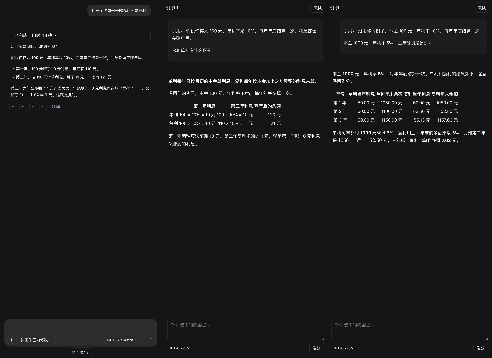

# SideQuest · 侧边追问

给 DeepSeek Harness 加一个「旁边聊」：**选中文字 → 侧边提问 → 继续往下追问**，不用打断主聊天，也不用反复复制上下文。



侧聊会带上父级上下文，可以继续展开下一层，没有预设层数上限。支持公式和可操作的 HTML 图表。

## 💡 为什么需要侧边追问 (Nested Inquiry)?

在处理复杂任务——特别是 STEM 和数学学习时，我们往往会遇到“路径分叉”：
*   **拆解复杂问题**：当你面对一个复杂的证明或公式推导，可以在侧边开启一个全新的上下文，专注于单一步骤的推导，验证无误后再回到主线。
*   **隔离探索与验证**：在数学建模或代码调试中，你可以开启一个临时的“草稿纸”侧聊，通过快速迭代尝试不同的变量或假设，而不影响主对话的连贯性。
*   **防止上下文污染**：侧边追问天然隔离了无关的探索路径，让你始终保持核心思路清晰。

它不仅仅是一个插件，更是你思维的“辅助内存”。

## 安装

需要 Node.js 22+、DSH，以及已登录 ChatGPT 的本地 Codex。

1. 下载并解压 [最新安装包](https://github.com/Keiyui0521/dsh-sidequest/releases)。
2. 在 `~/.config/dsh-sidequest/config.json` 填写工作区和 Codex 路径：

   ```json
   {
     "workspace": "/你的工作区绝对路径",
     "codexBin": "/codex可执行文件的绝对路径"
   }
   ```
3. 在 DSH「插件」中安装解压后的目录（`file:/绝对路径/package`），启用并重启。

侧聊是临时的，关闭或重启后不保留。所有侧聊使用配置的工作区；Codex 的文件操作权限独立于 DSH 主界面设置。

目前为实验版，基于 macOS / DSH 0.2.2-rc.3 验证。[详细说明](docs/guide.md) · [MIT](LICENSE)
