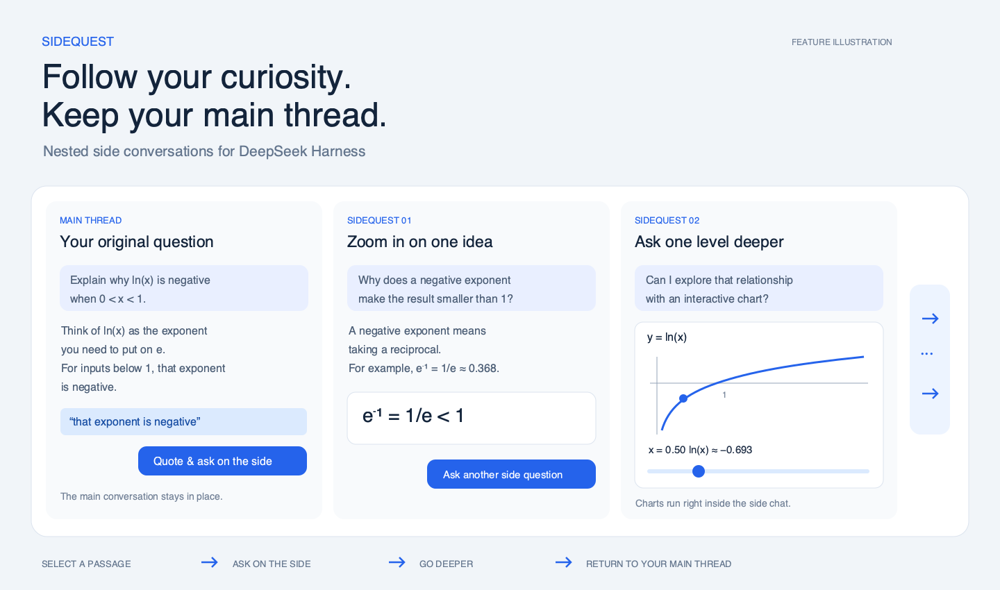
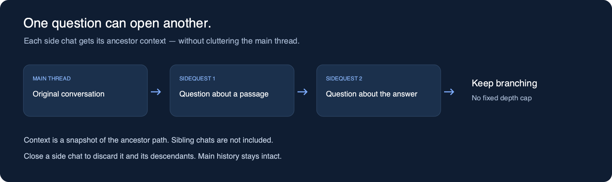

# SideQuest

**Follow your curiosity. Keep your main thread.**

Nested side conversations and interactive charts for **DeepSeek Harness**. Select a passage, ask a question beside it, then branch again when another question comes up.

[中文说明](README.zh-CN.md) · [How it works](#how-it-works) · [Install](#install) · [Limitations](#limitations)



*Feature illustration with fictional conversations, not a product screenshot.*

## How it works

1. Select text in the main conversation and choose **侧边提问** (ask on the side).
2. A side pane opens with the selected passage and a snapshot of the parent context.
3. Select text inside that pane to open another level. There is **no hard-coded depth limit**; available screen space, memory, and model context still matter.
4. Close a pane to discard it and its descendants. The main conversation remains in place.



- **Focused context:** ancestor conversations are passed to the model; only the local exchange is displayed. Sibling conversations are excluded.
- **Temporary side chats:** held in memory, not written to DSH session logs or localStorage. Closing the app also clears them.
- **Quote without branching:** the original quote action remains available.
- **Edit the last side question:** revise it and regenerate that branch. The public version leaves native main-chat editing alone.
- **Math and Markdown:** local KaTeX, Marked, and DOMPurify render answers.
- **Inline HTML charts:** local `.html` links render as isolated interactive frames inside the side chat. Legacy Work `visualize` markers are also recognized.
- **Local Codex adapter:** uses a locally installed Codex app-server and an existing ChatGPT login. This is an independent integration, not an official DeepSeek or OpenAI plugin.

## Install

Experimental release. The original local implementation was exercised on **macOS with DeepSeek Harness 0.2.2-rc.3**. This extracted, configurable distribution passes automated tests; a clean-machine installation and other DSH versions have not been verified.

### 1. Build the plugin

Prerequisites: Node.js 22+, npm, DeepSeek Harness, and a Codex executable supporting `app-server --stdio`. Sign in to Codex with ChatGPT before using the adapter.

```sh
git clone https://github.com/Keiyui0521/dsh-sidequest.git
cd dsh-sidequest
npm ci
npm run build
npm test
```

### 2. Choose the workspace

Copy `sidequest.config.example.json` to `~/.config/dsh-sidequest/config.json` and edit it:

```json
{
  "workspace": "/absolute/path/to/your/workspace",
  "codexBin": "/absolute/path/to/codex"
}
```

The workspace must exist. `codexBin` may be `codex` if it is on the DSH process's PATH. No account tokens or API keys belong in this file.

Optional environment overrides: `SIDEQUEST_CONFIG`, `SIDEQUEST_WORKSPACE`, and `SIDEQUEST_CODEX_BIN`.

**One configured workspace is used for all SideQuest requests**, including when the parent DSH chat belongs to another directory. Choose the workspace deliberately.

### 3. Load it in Harness

Use DSH's **Plugins** manager to install the built local directory as a bundle, using an absolute `file:/.../dsh-sidequest` package source. The bundle descriptor is `cordis.patch.yml`; it loads the `dsh-sidequest` package. Enable the bundle and fully restart Harness to load its injected browser dependencies and local transport.

Do not enable this beside the earlier private `dsh-math-study` plugin: both replace the same quote/menu slots. A GitHub source checkout requires the build step; no npm-registry release is implied.

## Interactive charts

Ask for a visualization. The adapter asks the model to create a self-contained HTML file in your configured workspace and return an absolute-path Markdown link:

```markdown
[Explore the chart](/absolute/path/to/your/workspace/chart.html)
```

The side chat replaces that link with an interactive frame. Scripts and styles must be inline. Charts have no network access; external CDNs, remote fonts, and dynamically imported assets are unsupported. Charts cannot access the parent app, open popups, or navigate its top-level window.

Files must resolve inside the configured workspace, have an `.html` or `.htm` extension, and be no larger than 2 MB. Symlink escapes are rejected. The chart file itself remains on disk even after its side chat is closed.

## Execution and privacy

- Codex performs tools in the configured workspace with `workspace-write` and `approvalPolicy: never`; escalation requests are declined. **DSH's native permission selector does not control this separate Codex process.** It can modify workspace files while answering.
- Requests are sent through your existing ChatGPT account. SideQuest does not handle or embed your login token. It refuses API-key account mode in its adapter.
- “Temporary” describes the plugin's local chat storage, not the provider's data-retention policy, Codex diagnostics, or files generated by tools.
- Transport listens on a random loopback port with a per-launch random path, origin checks, and no-store responses.
- HTML runs in an opaque sandbox with scripts enabled, but without same-origin, popup, form, or parent-navigation permissions. Markdown is sanitized separately.

## Limitations

- Chinese UI labels in this initial release; answers follow the user's language.
- Text conversations only in the side pane; image attachments are not supported.
- Parent context is a snapshot, refreshed when opening/re-quoting the child; it is not continuously synchronized.
- Deeper panes share the available width. “No depth cap” does not mean unlimited usable screen space or model context.
- DSH internal slot APIs and Codex's app-server protocol may change. Other plugins using the same slots may conflict.
- This release does not repair historical DSH session files or change the main chat's renderer.

## Development

```sh
npm run build
npm test
npm pack
```

Tests cover configuration, quote/context behavior, cancellation, authenticated transport, HTML-link parsing, workspace traversal/symlink rejection, and isolated frame configuration. They do not make paid model calls or claim full browser security verification.

MIT for SideQuest's own code. See [LICENSE](LICENSE) and [THIRD_PARTY.md](THIRD_PARTY.md).
