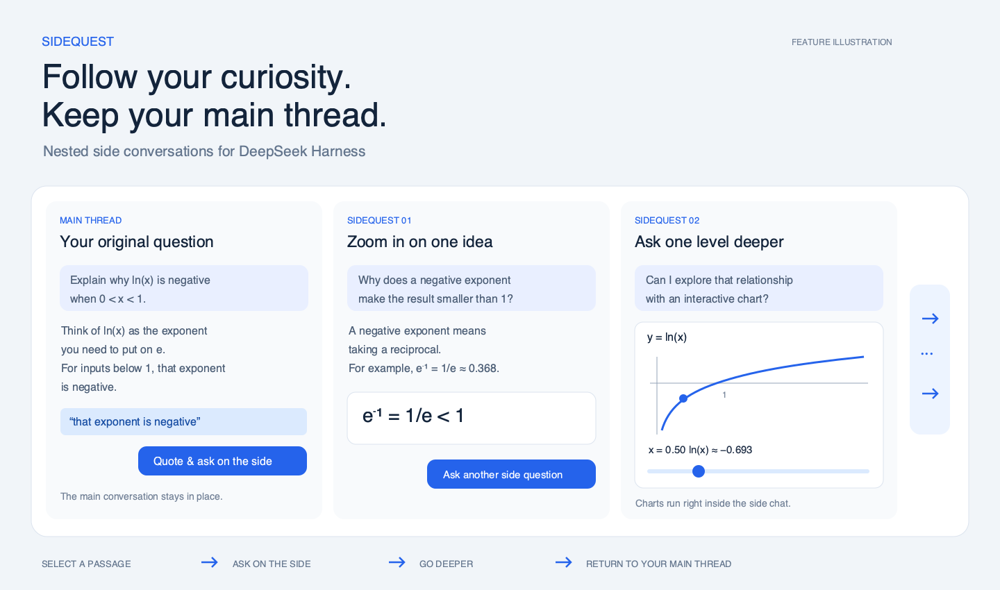
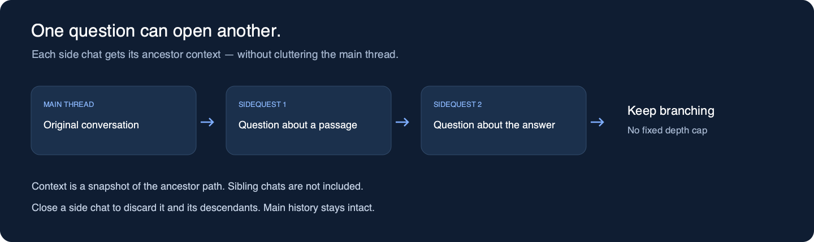

# SideQuest · 随时展开一段追问

**主线不丢，疑问往旁边聊。**

为 DeepSeek Harness 增加多层侧边聊天：选中一句话，在右侧追问；还有疑问，就从侧聊继续向右展开。

[English](README.md)



*使用虚构内容绘制的功能示意图，并非产品截图。*

## 像开支线一样提问

1. 在主聊天中选中文字，点击「侧边提问」。
2. 新侧栏带入引用内容和父级上下文，只显示自己的问答。
3. 在侧栏里再次选中文字，可以继续打开下一层。
4. 关闭一栏，会同时丢弃它和下级侧聊，主聊天仍保留。

代码没有预设层数上限。但窗口宽度、内存和模型上下文仍有限制，不代表可以无限扩张而没有成本。



支持普通引用、多层追问、修改侧聊最后一条问题、Markdown、数学公式，以及直接在侧聊中操作 HTML 图表。旧 Work `visualize` 标记也能识别。

## 安装

这是实验版。原始本地实现已在 macOS 的 **DSH 0.2.2-rc.3** 中使用；提取后的公开版本通过自动化测试，尚未验证全新机器安装和其他 DSH 版本。

需要 Node.js 22+、npm、DSH，以及支持 `app-server --stdio` 的本地 Codex。先通过 Codex 登录 ChatGPT 账号。

```sh
git clone https://github.com/Keiyui0521/dsh-sidequest.git
cd dsh-sidequest
npm ci
npm run build
npm test
```

将 `sidequest.config.example.json` 复制到 `~/.config/dsh-sidequest/config.json`，填写：

```json
{
  "workspace": "/absolute/path/to/your/workspace",
  "codexBin": "/absolute/path/to/codex"
}
```

工作区必须存在；如果 DSH 能从 PATH 找到 Codex，`codexBin` 可以填 `codex`。不需要在配置里写账号令牌或 API key。

然后在 DSH 的「插件」管理器中，以绝对路径 `file:/.../dsh-sidequest` 安装这个已构建的本地插件目录，启用并完整重启 DSH。仓库包含组合包描述 `cordis.patch.yml`。GitHub 源码必须先构建；本项目目前没有声称已发布到 npm。

请不要与旧版私用 `dsh-math-study` 同时启用，两者会占用相同界面插槽。

## 使用边界

- **一个配置的工作区供全部侧聊使用**，不会自动切换为父聊天的目录。
- 侧聊内容只在内存中，关闭侧栏或重启应用会丢弃。父级上下文在打开或重新引用时快照继承，不持续同步；兄弟侧聊不会传入。
- 本地 Codex 使用 `workspace-write` 和 `approvalPolicy: never` 执行文件操作，拒绝提权。**DSH 主界面的权限选择器不控制这个独立进程。** 模型可能修改所配置工作区的文件。
- 请求通过你的 ChatGPT 账号发送。“临时”只描述插件本地聊天存储，不代表服务商保留策略、Codex 诊断信息或工具生成的文件也会消失。
- 图表需要工作区内不超过 2 MB 的自包含 HTML，使用内联 CSS/JS。隔离预览不允许联网、访问父页面、开弹窗或跳转主窗口。
- 侧聊目前只支持文字输入，不支持图片附件；公开版不覆盖原生主聊天编辑，也不修复 DSH 历史文件。
- 这是独立项目，不是 DeepSeek 或 OpenAI 官方插件。DSH 内部接口和 Codex 协议升级可能带来兼容问题。

更多安装、测试和限制见 [English README](README.md)。项目自有代码使用 [MIT 许可证](LICENSE)；第三方依赖见 [THIRD_PARTY.md](THIRD_PARTY.md)。
